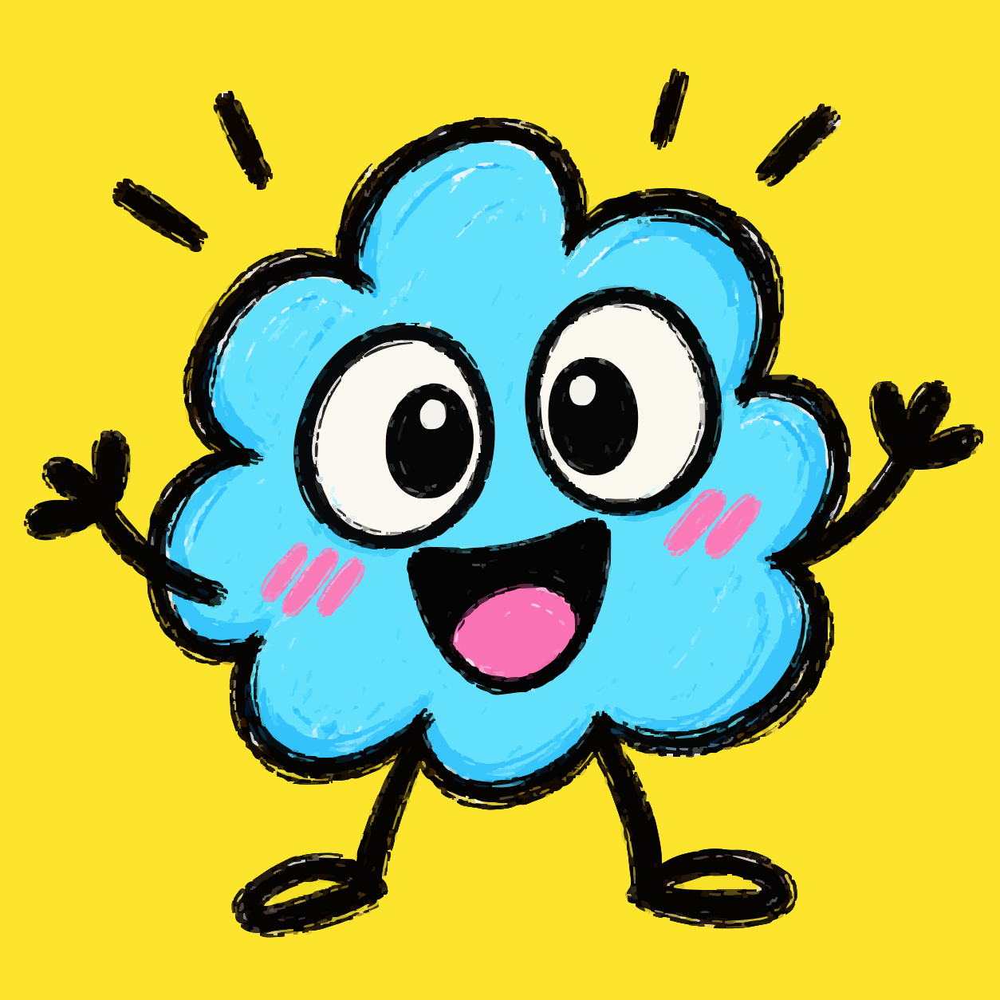
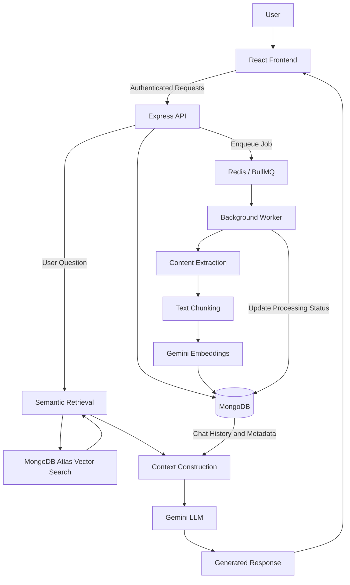

<div align="center">



# Brainly

### Your thoughts, connected.

Capture anything. Organize effortlessly. Find meaning in your own thoughts.

**An AI-powered personal knowledge base built around your notes, resources, and ideas.**

React · Express · MongoDB Atlas · Gemini · BullMQ

**Status:** Active development · Not deployed yet

</div>

---

<p align="center">
  <a href="#overview">Overview</a> ·
  <a href="#features">Features</a> ·
  <a href="#architecture">Architecture</a> ·
  <a href="#technology">Technology</a> ·
  <a href="#getting-started">Getting started</a> ·
  <a href="#roadmap">Roadmap</a>
</p>

## Overview

Brainly is a personal knowledge management application that makes saved information useful, not just searchable. Keep your notes and external resources in one workspace, then explore them through natural-language questions.

Under the hood, Brainly uses **Retrieval-Augmented Generation (RAG)**: it finds relevant information in your own knowledge base and supplies that context to Google Gemini when generating a response. Instead of searching every note manually, you can ask about the ideas you've collected.

<p align="center">
  
</p>
<p align="center"><sub>The knowledge workspace — a place to collect, organize, and revisit ideas.</sub></p>

## Features

| Organize | Discover | Ask |
| :--- | :--- | :--- |
| Save notes and supported external resources, with tags and metadata. | Retrieve relevant content by meaning using embeddings and vector search. | Ask questions grounded in your indexed content, with conversation history. |
### Knowledge Management

- Create, edit, organize, and manage personal notes.
- Categorize information using tags and metadata.
- Save resources from multiple sources, including text, PDFs, images, audio, video, websites, and YouTube links.
- Track content processing and indexing status.

### Semantic Search

- Generate vector embeddings from extracted document content using Google Gemini.
- Store and retrieve embeddings through MongoDB Atlas Vector Search.
- Find relevant information based on semantic similarity rather than exact keyword matches.
- Retrieve contextual text chunks from the user's knowledge base.

### RAG-Powered Conversations

- Ask natural-language questions about saved information.
- Generate AI responses grounded in retrieved knowledge.
- Maintain conversational context across follow-up questions.
- Include relevant source metadata when constructing prompts.
- Persist conversations and message history for future reference.

### Asynchronous Content Processing

- Queue ingestion tasks using BullMQ and Redis.
- Extract, chunk, and embed content through background workers.
- Keep API requests responsive while processing runs independently.
- Monitor processing progress, completion, and failures.

### Authentication and Data Isolation

- Secure protected API routes using JSON Web Tokens (JWT).
- Associate notes, chunks, chats, and messages with authenticated users.
- Enforce ownership checks at the backend to isolate user data.


Brainly also supports asynchronous content indexing, processing-status feedback, persistent chat sessions, JWT authentication, and backend-enforced user data isolation.

### Capture what matters

Create notes, group information with tags, and save resources such as text, PDFs, images, audio/video, websites, and YouTube links. Supported content is processed in the background, keeping note creation separate from extraction and embedding work.

<p align="center">
  
</p>
<p align="center"><sub>Note creation — capture an idea now and return to it later.</sub></p>

> **Content processing:** Being able to save a source does not guarantee that all of its media can be extracted or indexed. Extraction depends on the configured processor for each source type.

### Find information by meaning

Brainly splits extracted text into searchable chunks, generates Gemini embeddings, and stores the chunks with source references in MongoDB. MongoDB Atlas Vector Search retrieves content that is semantically related to your question, even when the wording differs from the original note.

### Continue the conversation

Ask questions across your authorized knowledge base. Brainly combines retrieved chunks, relevant source metadata, and a bounded window of recent chat history to give Gemini the context needed for a response. Chats and messages are saved so you can return to them later.

## Architecture

Brainly separates the interactive API from background ingestion and connects both to a shared data layer.



### Content Ingestion Pipeline

1. **Resource creation:** The user creates a note or submits a supported resource.
2. **Persistence:** The backend validates the request and stores the resource with its authenticated owner.
3. **Job scheduling:** A processing job is added to BullMQ through Redis.
4. **Content extraction:** A background worker extracts text using the appropriate processor.
5. **Chunking:** Extracted text is divided into smaller segments suitable for retrieval.
6. **Embedding generation:** Gemini converts the text chunks into vector representations.
7. **Indexing:** Chunks, embeddings, and associated metadata are persisted in MongoDB for vector search.
8. **Status updates:** The worker updates processing state to reflect progress, completion, or failure.

This architecture keeps ingestion separate from request handling and allows processing to run asynchronously.

### RAG Query Pipeline

1. **Question submission:** The user submits a natural-language question within a chat.
2. **Semantic retrieval:** The backend searches the user's indexed knowledge for relevant text chunks.
3. **Context construction:** Retrieved chunks, source metadata, and recent conversation history are assembled into a prompt.
4. **Response generation:** Gemini generates an answer using the supplied context.
5. **Conversation persistence:** The user's message and AI response are stored for future interactions.

This workflow combines semantic retrieval with conversational generation, allowing users to explore their knowledge without manually searching individual documents.

---

<p align="center">
  
</p>
<p align="center"><sub>Ask Your Notes — explore saved knowledge through natural-language conversation.</sub></p>

## Technology

| Layer | Technology | Responsibility |
| :--- | :--- | :--- |
| Frontend | React, Vite | Notes, search, chat, and processing-status interface |
| API | Node.js, Express | Authentication, resource handling, and RAG orchestration |
| Database | MongoDB, Mongoose | Users, notes, conversations, chunks, and embeddings |
| Authentication | JSON Web Tokens (JWT) | Authenticated requests and user-scoped authorization |
| Background processing | BullMQ, Redis | Asynchronous ingestion jobs |
| Embeddings | Google Gemini Embeddings | Vector representations of text chunks |
| Retrieval | MongoDB Atlas Vector Search | Semantic similarity search |
| Generation | Google Gemini | Answers generated from retrieved context |

### Data model

The core entities are `User`, `Note`, `NoteChunk`, `Chat`, and `ChatMessage`.

- **User:** Account identity.
- **Note:** Saved content, tags, source metadata, owner, and processing state.
- **NoteChunk:** Extracted text, embedding, chunk index, and parent-note reference.
- **Chat:** Conversation metadata and owner.
- **ChatMessage:** Message role, content, timestamp, and parent-chat reference.

### Data Isolation

User-specific resources are accessed through backend-enforced ownership constraints.

Authenticated user identity is derived from verified JWT claims rather than client-supplied owner identifiers. Retrieval and database operations must respect these constraints to prevent cross-user data exposure.

---


## Getting started

These instructions reflect the documented React/Vite frontend and `backend/` API layout. Check your actual `package.json` scripts and worker entry point if your project structure differs.

### Prerequisites

- Node.js and npm
- MongoDB (MongoDB Atlas with a configured Vector Search index for semantic retrieval)
- Redis for BullMQ workers
- Google Gemini API key
- Google OAuth configuration for sign-in

### 1. Clone and install

```bash
git clone <your-repository-url>
cd <your-repository-directory>

# Frontend (repository root)
npm install

# Backend
cd backend
npm install
```

### 2. Configure environment variables

Create `backend/.env` using the variable names expected by your backend. For example:

```dotenv
PORT=5000
MONGODB_URI=your_mongodb_connection_string
JWT_SECRET=replace_with_a_long_random_secret
GEMINI_API_KEY=your_gemini_api_key
REDIS_HOST=127.0.0.1
REDIS_PORT=6379
CLIENT_URL=http://localhost:5173
```

For the React/Vite frontend, configure the backend URL in the environment file read by your app (for example, `.env` at the repository root):

```dotenv
VITE_BACKEND=http://localhost:5000
```

Configure any additional Google OAuth client settings required by your project. Never place backend secrets in `VITE_` variables or commit `.env` files.

### 3. Start the services

Start Redis locally, then open separate terminals for the API, worker, and frontend:

**API — from `backend/`:**

```bash
npm run dev
```

**Worker — from `backend/` (example entry point):**

```bash
node src/workers/noteWorker.js
```

**Frontend — from the repository root:**

```bash
npm run dev
```

Ensure your MongoDB Atlas Vector Search index matches the embedding field and model dimensions configured by the backend. Your API and worker both need access to MongoDB, Redis, and Gemini as appropriate.

### First-time experience

The welcome flow introduces the three main actions: creating notes, saving links, and asking questions about saved knowledge.

<p align="center">
  
</p>
<p align="center"><sub>A quick introduction before building your personal knowledge base.</sub></p>

## Security considerations

- Keep credentials, tokens, and API keys in server-side configuration.
- Authenticate protected endpoints and derive identity from verified JWT claims.
- Apply ownership filters to notes, chunks, chats, and messages, including vector retrieval.
- Control access to private uploads and source material.
- Validate requests and treat retrieved or externally supplied content as untrusted when constructing prompts.

## Roadmap

- [ ] Improve ingestion reliability, retries, and recovery from failed jobs.
- [ ] Evaluate retrieval quality, chunking, and relevance thresholds.
- [ ] Improve citations and source attribution in generated answers.
- [ ] Add stronger tests for multi-turn RAG conversations.
- [ ] Introduce usage limits and API cost monitoring.
- [ ] Add production deployment and operational monitoring.
- [ ] Explore knowledge graphs, cross-note connections, and knowledge reports.

Roadmap items are planned or exploratory, not promises of currently available functionality.

## Contributing

Issues, suggestions, and bug reports are welcome while Brainly is under active development. For pull requests, describe your change, include relevant testing notes, and do not commit secrets or user data.

## License

A license has not yet been specified. Until one is added, no general permission to reuse, modify, or redistribute the source code is granted.

---

<div align="center">

**Brainly — Turn information into knowledge.**

</div>
