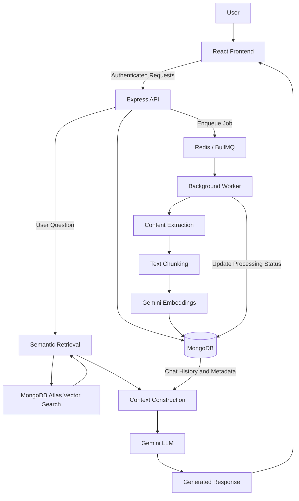

# Brainly

**Your personal knowledge base, powered by AI.**

Brainly is an AI-powered personal knowledge management application that helps you capture information, organize resources, and interact with your knowledge through natural language.

Built with **Retrieval-Augmented Generation (RAG)**, Brainly combines semantic search, vector embeddings, and large language models to turn scattered information into accessible, contextual knowledge.

**Project Status:** Active Development | Not Yet Deployed

---

## Overview

Information is easy to collect but difficult to retrieve when it matters.

Brainly addresses this challenge by providing a centralized workspace for managing personal knowledge. Users can save notes, organize external resources, and ask questions directly against their own content.

Unlike traditional search systems that rely primarily on keyword matching, Brainly uses semantic retrieval to identify relevant information based on meaning and context. Retrieved content is then provided to a language model to generate grounded, context-aware responses.

The goal is simple: **make personal knowledge easier to organize, retrieve, and use.**


<h2 align="center">Application Preview</h2>

<p align="center">
  A glimpse into Brainly — your personal space to capture,
  organize, and explore knowledge with AI.
</p>

<table>
  <tr>
    <td width="50%" align="center">
      
      <br />
      <b>Knowledge Dashboard</b>
    </td>
    <td width="50%" align="center">
      
      <br />
      <b>Notes & AI Workspace</b>
    </td>
  </tr>
  <tr>
    <td width="50%" align="center">
      
      <br />
      <b>Note Creation</b>
    </td>
    <td width="50%" align="center">
      
      <br />
      <b>Welcome Experience</b>
    </td>
  </tr>
</table>


## Features

### Knowledge Management

- Create, edit, organize, and manage personal notes.
- Categorize information using tags and metadata.
- Save resources from multiple sources, including text, PDFs, images, audio, video, websites, and YouTube links.
- Track content processing and indexing status.

### Semantic Search

- Generate vector embeddings from extracted document content using Google Gemini.
- Store and retrieve embeddings through MongoDB Atlas Vector Search.
- Find relevant information based on semantic similarity rather than exact keyword matches.
- Retrieve contextual text chunks from the user's knowledge base.

### RAG-Powered Conversations

- Ask natural-language questions about saved information.
- Generate AI responses grounded in retrieved knowledge.
- Maintain conversational context across follow-up questions.
- Include relevant source metadata when constructing prompts.
- Persist conversations and message history for future reference.

### Asynchronous Content Processing

- Queue ingestion tasks using BullMQ and Redis.
- Extract, chunk, and embed content through background workers.
- Keep API requests responsive while processing runs independently.
- Monitor processing progress, completion, and failures.

### Authentication and Data Isolation

- Secure protected API routes using JSON Web Tokens (JWT).
- Associate notes, chunks, chats, and messages with authenticated users.
- Enforce ownership checks at the backend to isolate user data.

**Note:** Resource support depends on the extraction processor implemented for each media type. Saving a resource does not necessarily guarantee that its entire content can be extracted or indexed.

---

## Tech Stack

| Layer | Technologies | Purpose |
|---|---|---|
| Frontend | React, Vite | User interface and client-side application |
| Backend | Node.js, Express | REST APIs and application logic |
| Database | MongoDB, Mongoose | Persistent storage and data modeling |
| Authentication | JWT | Authentication and protected resource access |
| Job Queue | BullMQ, Redis | Asynchronous task management |
| Embeddings | Google Gemini Embeddings | Vector representation of content |
| LLM | Google Gemini | Context-aware response generation |
| Vector Database | MongoDB Atlas Vector Search | Semantic similarity search |

## System Architecture

Brainly separates user-facing API operations from resource-intensive content processing and AI retrieval workflows.



### Content Ingestion Pipeline

1. **Resource creation:** The user creates a note or submits a supported resource.
2. **Persistence:** The backend validates the request and stores the resource with its authenticated owner.
3. **Job scheduling:** A processing job is added to BullMQ through Redis.
4. **Content extraction:** A background worker extracts text using the appropriate processor.
5. **Chunking:** Extracted text is divided into smaller segments suitable for retrieval.
6. **Embedding generation:** Gemini converts the text chunks into vector representations.
7. **Indexing:** Chunks, embeddings, and associated metadata are persisted in MongoDB for vector search.
8. **Status updates:** The worker updates processing state to reflect progress, completion, or failure.

This architecture keeps ingestion separate from request handling and allows processing to run asynchronously.

### RAG Query Pipeline

1. **Question submission:** The user submits a natural-language question within a chat.
2. **Semantic retrieval:** The backend searches the user's indexed knowledge for relevant text chunks.
3. **Context construction:** Retrieved chunks, source metadata, and recent conversation history are assembled into a prompt.
4. **Response generation:** Gemini generates an answer using the supplied context.
5. **Conversation persistence:** The user's message and AI response are stored for future interactions.

This workflow combines semantic retrieval with conversational generation, allowing users to explore their knowledge without manually searching individual documents.

---

## Data Models

Brainly uses MongoDB with Mongoose to manage application data.

| Model | Description |
|---|---|
| `User` | User accounts and identity |
| `Note` | Saved content, metadata, tags, ownership, and processing status |
| `NoteChunk` | Extracted text segments, embeddings, and parent-note references |
| `Chat` | Conversation metadata and ownership |
| `ChatMessage` | Individual messages, roles, timestamps, and chat references |

### Data Isolation

User-specific resources are accessed through backend-enforced ownership constraints.

Authenticated user identity is derived from verified JWT claims rather than client-supplied owner identifiers. Retrieval and database operations must respect these constraints to prevent cross-user data exposure.

---

## Getting Started

### Prerequisites

Ensure the following services and dependencies are available:

- Node.js and npm
- MongoDB Atlas or a compatible MongoDB instance
- Redis
- Google Gemini API key
- MongoDB Atlas Vector Search index for semantic retrieval

### 1. Clone the Repository

```bash
git clone <repository-url>
cd <repository-directory>
```

### 2. Install Frontend Dependencies

From the project root:

```bash
npm install
```

If required by the frontend configuration, create a `.env` file and configure the appropriate Vite environment variables.

Only non-sensitive configuration should be exposed through `VITE_`-prefixed variables.

### 3. Configure the Backend

Navigate to the backend directory and install dependencies:

```bash
cd backend
npm install
```

Create a `.env` file inside the `backend` directory.

Example configuration:

```env
PORT=5000
MONGODB_URI=your_mongodb_connection_string
JWT_SECRET=your_secure_jwt_secret
GEMINI_API_KEY=your_gemini_api_key

REDIS_HOST=127.0.0.1
REDIS_PORT=6379

CLIENT_URL=http://localhost:5173
```

These variable names are illustrative. Refer to the backend configuration for the exact environment variables required by the application.

Never commit API keys, credentials, or environment files containing secrets.

### 4. Start Redis

Start the Redis service using your preferred installation method.

Ensure the service is accessible using the host and port configured in your backend environment.

### 5. Start the Backend Server

From the `backend` directory:

```bash
npm run dev
```

This assumes a `dev` script is defined in `backend/package.json`.

### 6. Start the Background Worker

Open a separate terminal and run:

```bash
cd backend
node src/workers/noteWorker.js
```

The background worker must have access to the relevant MongoDB, Redis, and Gemini configuration.

Its entry point may differ depending on the project structure.

### 7. Start the Frontend

From the project root:

```bash
npm run dev
```

Open the local development URL provided by Vite.

**Important:** Verify the scripts in each `package.json` and adjust the commands according to your actual project structure.

---

## Security Considerations

Brainly handles user-owned information and AI-generated content, making secure data access an important architectural requirement.

Key considerations include:

- **Authentication:** Require valid JWTs for protected endpoints.
- **Authorization:** Enforce resource ownership at the API and database layers.
- **Secret management:** Store API keys and credentials in server-side environment variables.
- **Data isolation:** Apply user-specific filters during note, conversation, and vector retrieval operations.
- **File access:** Restrict access to uploaded files and private source materials.
- **Input validation:** Validate incoming requests before processing or persistence.
- **Prompt safety:** Treat retrieved documents and external content as untrusted data when constructing model prompts.

---

## Roadmap

Brainly is under active development. Planned improvements include:

- [ ] Improve ingestion reliability, retries, and error handling.
- [ ] Optimize chunking strategies and semantic retrieval quality.
- [ ] Improve source attribution and references in AI-generated responses.
- [ ] Expand automated testing for retrieval and multi-turn conversations.
- [ ] Introduce API usage limits and AI cost monitoring.
- [ ] Improve monitoring and observability for background workers.
- [ ] Prepare the application for production deployment.
- [ ] Explore knowledge graphs and relationships between notes.
- [ ] Investigate AI-generated knowledge summaries and personal insights.

Roadmap items represent planned or exploratory work and are subject to change.

---

## Contributing

Contributions, suggestions, and bug reports are welcome.

If you would like to contribute:

1. Open an issue to discuss a proposed feature or bug fix.
2. Create a branch for your changes.
3. Implement and test your changes.
4. Submit a pull request explaining the implementation and any relevant testing.

Please avoid including secrets, credentials, or private user information in issues and pull requests.

## License

A license has not yet been specified for this project.

Until a license is added, no general permission to use, modify, or redistribute the source code is granted.

---

**Brainly — Turn information into knowledge.**
